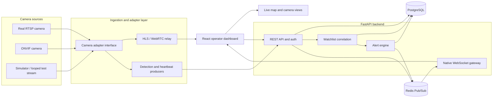

# System Architecture

The prototype separates camera protocol concerns from the operational API and dashboard. Camera adapters normalize source metadata and detection payloads before they reach the backend. Redis provides event fan-out for multiple API/WebSocket workers, while PostgreSQL remains the durable source of truth.

## Runtime responsibilities

- **Camera sources:** physical RTSP/ONVIF devices or the local simulator.
- **Adapter layer:** translates source-specific protocols into normalized camera, heartbeat, and detection contracts.
- **FastAPI API:** validates requests, persists operational data, and exposes OpenAPI documentation.
- **Watchlist correlation and alert engine:** match normalized detection identifiers and create actionable alerts.
- **Redis Pub/Sub:** distributes real-time events across backend workers without making Redis the source of truth.
- **WebSocket gateway:** forwards event fan-out to connected dashboard operators.
- **React dashboard and map:** presents live camera status, video, detections, and alerts.
