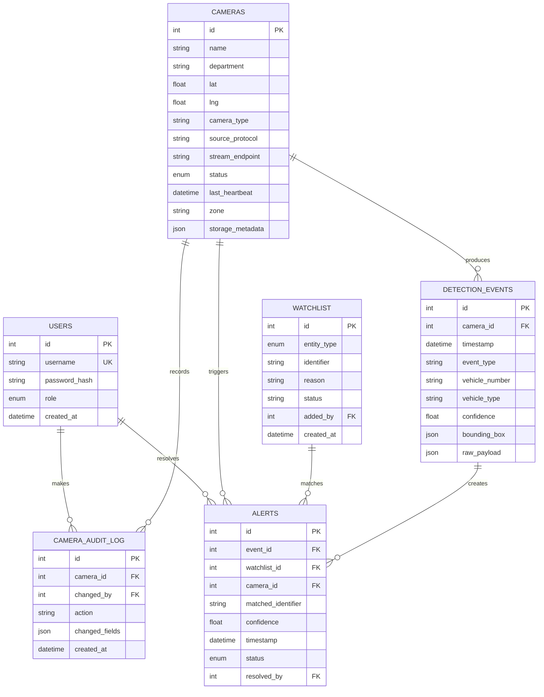

# Entity Relationship Diagram

The database keeps detection events immutable and links alerts back to the event, matched watchlist item, and source camera. JSONB columns retain vendor-specific payload details without forcing schema changes for every camera integration.
